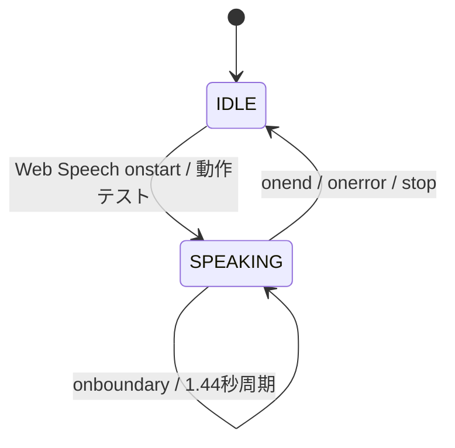

# HARO V2 — 承認GIFに基づくインタラクティブSVG設計

## 位置づけ

3体のハロをPNG/GIF/動画で表示するのではなく、**SVGの構造要素**として描画する。
承認GIFは外観と動作タイミングの参照資料であり、ソースに同梱・埋め込みしない。
オレンジが中央前面、緑が左後方、紫（攻撃的なCHAOS）が右後方。

## コンポーネント構成（3体共通）

| SVG部品 | 実装要素 | 備考 |
|---|---|---|
| 球体外装 | `circle.haro-shell` と陰影用の`path` | 装甲色のグラデーションのみキャラクター別 |
| 左／右耳 | `g.hatch-left`, `g.hatch-right` | 左耳を反転し同一形状の右耳を生成 |
| 耳内部 | `g.ear-cavity` | マルーン色の窪み、金色のコイル6枚、回転軸 |
| 耳外装 | `path.hatch-under`, `path.hatch-face` | 外装と裏面を別レイヤーとし、立体的に回転 |
| 目 | `g.eye-pair` | オレンジ・緑は楕円、紫は鋭角の赤色の眼 |
| 台座 | 複数の金属調パス | 前面留め金、金属面反射を再現 |

## 動作シーケンス

GIFの8フレーム×180msを1周期1.44秒としてCSSアニメーションに変換。
各側の回転角度は近似値で、完全な3D空間の投影ではない。

| 時点 | 左耳（度） | 右耳（度） | 目 |
|---|---:|---:|---|
| 0% | 0 | 0 | 消灯 |
| 12.5% | 29 | 23 | 消灯 |
| 25% | 60 | 54 | 発光開始 |
| 37.5% | 90 | 87 | 点灯 |
| 50〜62.5% | 105 | 103 | 最大発光 |
| 75% | 48 | 52 | 発光減少 |
| 87.5% | 17 | 18 | 消灯へ |
| 100% | 0 | 0 | 消灯 |

### 状態遷移

- IDLE: 左右の外装を球体へ戻し、目の点滅を停止
- SPEAKING: 発話している1体だけ開閉。別の2体は待機状態のまま
- `HaroVectorMotionController` が状態と選択ユニットを管理
- `HaroSpeechController` が音声イベントを通知する
- 入力したテキスト／音声起動／3AI討論は従来のハンドラを流用
- 参考GIFの動きに合わせて耳の左右で少し開度を変えている
- スマートフォン幅は`@media(max-width:560px)`でサイズと重なりを調整

## 変更の対象外

ロト7予測API・機械学習・三者の評価・MySQL・CSV解析・音声起動文言を変えない。

## 確認手順

1. Previewを開き「AIハロ起動」を押す
2. 通常時の3体の耳・目と位置を確認
3. 緑／オレンジ／紫のいずれかを選び「耳・目の動作テスト」を押す
4. 選択個体だけ耳が外側・上に開き、内側コイルが現れ、目が発光するか確認
5. 約4.6秒経過後に全パーツが閉じた状態へ戻ることを確認
6. 音声起動・音声読み上げ・SCAN予測・CSV取込に影響がないことを確認

## 制限

GIFとピクセル完全一致の自動トレースではなく、SVG形状・塗り・影・アニメーションを個別に再設計したもの。
最終的な実音声との一致やSafari実機の描画は、対象端末で確認する必要がある。
